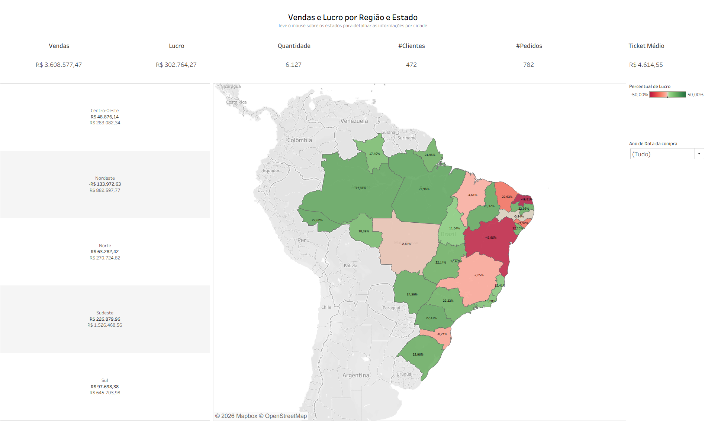
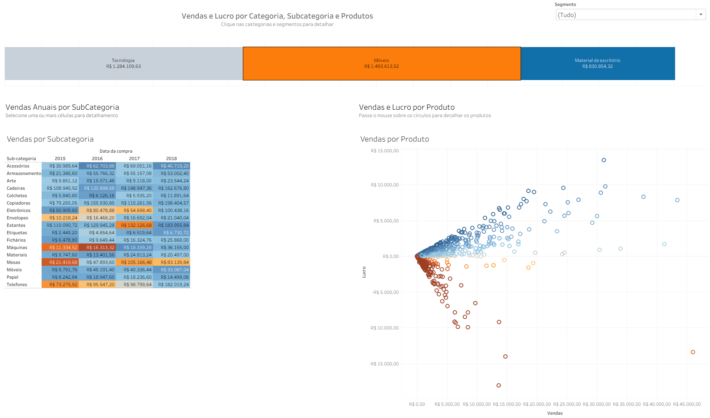

# Análise de Vendas – Superloja (Tableau)

Projeto de estudo em Tableau usando a base de exemplo **Superloja** (versão em português do *Sample Superstore*). Ele analisa vendas e lucro por região, estado, cidade, categoria e produto, e mostra como as vendas evoluem no tempo.

## Painéis

### Vendas e Lucro por Região e Estado

- Indicadores no topo: vendas, lucro, quantidade, clientes, pedidos e ticket médio
- Lucro e vendas por região brasileira
- Mapa dos estados colorido pelo percentual de lucro (vermelho = prejuízo, verde = lucro)
- Ao passar o mouse sobre um estado, aparecem os detalhes por cidade
- Filtro por ano da compra

### Vendas e Lucro por Categoria, Subcategoria e Produtos

- Vendas por categoria (Tecnologia, Móveis, Material de escritório), que funcionam como filtro do painel
- Tabela de calor com as vendas anuais por subcategoria (2015–2018)
- Dispersão de vendas × lucro por produto, destacando os produtos que dão prejuízo
- Filtro por segmento de cliente

## Conteúdo

| Arquivo | Descrição |
|---|---|
| `Vendas por cidade.twb` | Pasta de trabalho do Tableau com as planilhas e os painéis |
| `Exemplo-Superloja.xlsx` | Base de dados (aba `Compras`, cerca de 10 mil linhas) |
| `imagens/` | Capturas de tela dos painéis |

## Campos calculados

| Campo | Fórmula |
|---|---|
| Percentual de Lucro | `SUM([Lucro]) / SUM([Vendas])` |
| Ticket médio | `SUM([Vendas]) / COUNTD([ID da compra])` |

## Conceitos praticados

- Conexão com fonte de dados Excel
- Campos calculados e funções de agregação (`SUM`, `COUNTD`)
- Mapas geográficos com cor divergente
- Tabelas de calor, gráficos de barras, dispersão e séries temporais
- Painéis com filtros e ações interativas (dicas de ferramenta e filtragem entre gráficos)

## Como abrir

1. Instale o [Tableau Public](https://www.tableau.com/products/public/download) (gratuito) ou o Tableau Desktop. A pasta de trabalho foi salva na versão **2026.1**.
2. Clone ou baixe este repositório.
3. Abra `Vendas por cidade.twb`. A planilha `Exemplo-Superloja.xlsx` precisa estar na mesma pasta.
